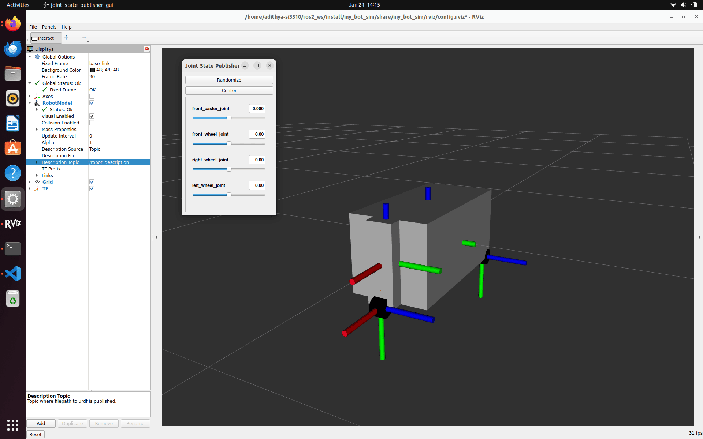
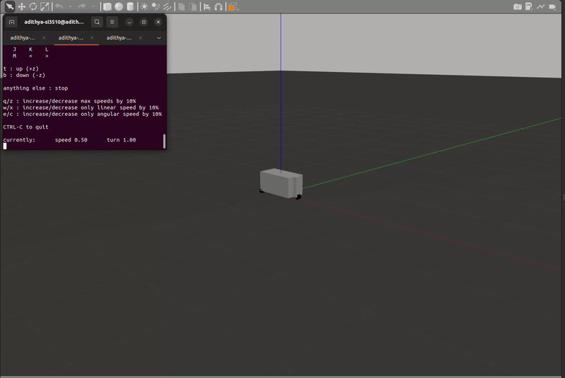
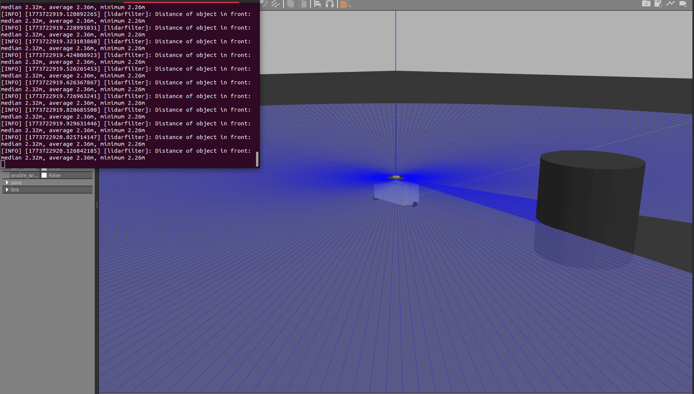
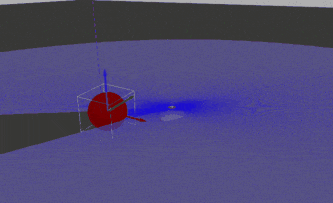
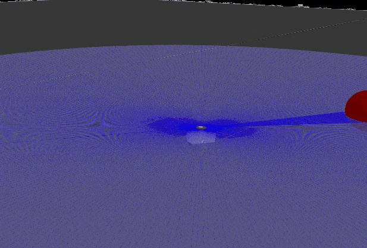

# TortoiseBot ROS 2 Workspace

**Intern:** Adithya S
**Stack:** ROS 2 Humble · Ubuntu 22.04 LTS · Gazebo (Classic) · RViz2 · Python (rclpy)

## Contents
1. [Workspace Setup](#workspace-setup)
2. [Simulate TortoiseBot](#simulate-tortoisebot)
3. [Get Object Distance](#get-object-distance)
4. [Follow a Ball](#follow-a-ball)

## Repository Layout
```
tortoisebot_ws/
├── docs/images/                 # screenshots and demo GIFs used in this README
└── src/
    ├── tortoisebot_description/ # robot URDF + RViz launch        (Simulate TortoiseBot)
    ├── tortoisebot_gazebo/      # Gazebo world + spawn launch     (Simulate TortoiseBot)
    └── my_bot_sim/              # LIDAR robot, scripts, ball      (Get Object Distance, Follow a Ball)
```

## Workspace Setup
Install the dependencies once:
```bash
sudo apt install ros-humble-gazebo-ros-pkgs ros-humble-teleop-twist-keyboard \
                 ros-humble-joint-state-publisher-gui ros-humble-robot-state-publisher ros-humble-rviz2
```
Clone, build and source:
```bash
git clone <your-repo-url> tortoisebot_ws
cd tortoisebot_ws
colcon build
source install/setup.bash
```
Run `source install/setup.bash` in every new terminal.

---

## Simulate TortoiseBot
Simulate the TortoiseBot in a physics-based Gazebo environment and drive it with keyboard teleoperation.

**Packages:** `tortoisebot_description`, `tortoisebot_gazebo`

### Step-by-step
1. **Create the workspace** to hold all the packages (`ros2_ws/src`).
2. **Create `tortoisebot_description`** to manage the robot model and RViz visualization:
   ```bash
   cd ~/ros2_ws/src
   ros2 pkg create tortoisebot_description --build-type ament_cmake
   ```
3. **Add the URDF.** The TortoiseBot URDF from the Asimov / OSRF resources
   ([source](https://github.com/osrf/rosbook/blob/master/code/tortoisebot/tortoisebot.urdf))
   is placed in `urdf/` and updated for ROS 2 / Gazebo:
   - inertial properties (mass and inertia) added to every link
   - `<collision>` geometry added for every visual link
   - Gazebo differential-drive plugin tags updated for `libgazebo_ros_diff_drive.so`
4. **Create the RViz launch file** `launch/spawn_tortoisebot.launch.py`. It starts:
   - `robot_state_publisher`
   - `joint_state_publisher_gui`
   - `rviz2`

   It is used to verify the robot's appearance, check joint movement and confirm the TF tree. A saved RViz config loads the robot model and fixed frame automatically.
5. **Create `tortoisebot_gazebo`** to manage the simulation:
   ```bash
   ros2 pkg create tortoisebot_gazebo --build-type ament_cmake
   ```
   `worlds/empty_world.world` contains a ground plane and default lighting. `launch/gazebo.launch.py` starts Gazebo through `gazebo_ros`, runs `robot_state_publisher` and spawns the robot with `spawn_entity.py`.
6. **Build and source**
   ```bash
   cd ~/ros2_ws
   colcon build
   source install/setup.bash
   ```
7. **Verify in RViz** (robot model visible, correct fixed frame, TF published):
   ```bash
   ros2 launch tortoisebot_description spawn_tortoisebot.launch.py
   ```
8. **Launch the Gazebo simulation** to test the physics behaviour:
   ```bash
   ros2 launch tortoisebot_gazebo gazebo.launch.py
   ```
9. **Teleoperate** from a new terminal once the physics and wheel placement look correct:
   ```bash
   ros2 run teleop_twist_keyboard teleop_twist_keyboard
   ```

### Results
**RViz2:** the 3D model renders correctly with all links and joints.



**Gazebo + teleoperation:** the robot moves linearly and angularly in response to `teleop_twist_keyboard` on `/cmd_vel`.



### Challenges solved
| Problem | Solution |
|---|---|
| The original URDF was written for ROS 1. In ROS 2 `robot_description` is not a global parameter, and the plugins use different XML schemas. | The launch file reads the URDF as a string and passes it to `robot_state_publisher` as a parameter. Plugin tags were changed to the ROS 2 snake_case equivalents for `libgazebo_ros_diff_drive.so`. |
| The model did not appear in RViz, or showed status "Error". The description topic had not been published yet. | Select the Fixed Frame, add RobotModel, set Description Source to *Topic* with `/robot_description`, then enable visibility and set Alpha to 1.0. |
| The robot showed in RViz but not in Gazebo, or Gazebo crashed after spawning, or the wheels did not work. | Added mass and inertia to every link (ODE ignores zero-mass objects), added `<collision>` tags matching `<visual>`, and added `<mu>` friction tags to the wheel links. |

---

## Get Object Distance
Use the LIDAR sensor in the Gazebo TortoiseBot simulation to detect the closest object directly in front of the robot.

**Package:** `my_bot_sim`

### Step-by-step
1. **Add the LIDAR link to the URDF**: a cylinder (radius 0.05, depth 0.04) parented to `base_link`.
2. **Add a `ray` sensor** to the URDF and set the min/max angle and range.
3. **Add the `libgazebo_ros_ray_sensor.so` plugin** to publish `sensor_msgs/LaserScan` on `/scan`. The fields used are:
   - `ranges[]`: distance readings
   - `angle_min`: starting angle (rad)
   - `angle_increment`: angle between samples (rad)
4. **Write the node** `scripts/lidar_filter.py` (basic `rclpy` node).
5. **Create the subscriber and publisher.** The node subscribes to `/scan` and publishes the result on `/output_distance` (`std_msgs/Float32MultiArray`).
6. **In the callback**, take the front sector of **+15° / −15°**, converted to radians, and use `angle_increment` to find the matching indices.
7. **Filter the readings.** Invalid values (`inf`, `NaN`, below `range_min`, above `range_max`) caused by sensor limits or reflections are dropped. From the valid ranges, the **median**, **moving average** and **minimum** are computed and published.
8. **Build and source**
   ```bash
   cd ~/ros2_ws
   colcon build
   source install/setup.bash
   ```
9. **Launch Gazebo** with the LIDAR-equipped URDF in an empty world. Add an object (cube or sphere) in front of the robot:
   ```bash
   ros2 launch my_bot_sim gazebo.launch.py
   ```
10. **Run the node**
    ```bash
    ros2 run my_bot_sim lidar_filter.py
    ```
    It prints the distance of the object, or a warning that the path is clear if nothing is detected.
11. **Verify**
    ```bash
    ros2 topic list                  # /scan and /output_distance should be listed
    ros2 topic echo /output_distance
    ```

### Results
The node subscribes to `/scan`, computes the closest distance in the front sector and reports the median, average and minimum. Example output (`data: [median, minimum, average]`):
```
data:
- 2.3169803619384766
- 2.260084390640259
- 2.354973554611206
```
If nothing is in range, it prints the warning `Path is clear No Object in front`.



### Challenges solved
| Problem | Solution |
|---|---|
| The LIDAR gives only `ranges`, min/max angle and increment, so it is hard to find the −15° and +15° readings. | Treat the scan as steps of `angle_increment` around 0°. The 15° offset becomes an index count, so the front sector is taken with list slicing and only that slice is processed. |

---

## Follow a Ball
Use the same TortoiseBot and LIDAR setup to follow a moving red ball: detect the direction and distance of the closest object from the LIDAR data, then publish velocity commands on `/cmd_vel` so the robot follows it slowly.

**Package:** `my_bot_sim`

### Step-by-step
1. **Reuse the URDF** of the TortoiseBot with the LIDAR sensor.
2. **Write `scripts/finding_obstracle.py`.** It finds the closest object and publishes `[angle, distance]` on `/object_info`.
   1. Subscribe to `/scan`.
   2. Filter invalid values (`inf`, `NaN`, below the minimum).
   3. Find the minimum distance among the valid readings (the closest obstacle).
   4. Get its angle from the index in the `ranges` array.
   5. Publish `[angle, distance]` as an array.
3. **Write `scripts/object_follow.py`.** It follows the closest object using `/cmd_vel`.
   1. Subscribe to `/object_info`.
   2. Set the robot's offset angle (180° bot direction) and compute the error against the object angle.
   3. Compute the angular correction with a PD controller.
   4. If the error is above the threshold, set `angular.z` to the control value to face the object.
   5. If the distance is greater than **1.8**, publish `linear.x = 1.0` to move forward, and stop when closer.
4. **Create the ball.** `urdf/ball.urdf` is a red sphere with the `libgazebo_ros_planar_move.so` plugin, so it moves from velocity commands on `/ball/cmd_vel`.
5. **Move the ball** with `teleop_twist_keyboard` remapped to `/ball/cmd_vel`, or with `scripts/ball_move.py`, which publishes to `/ball/cmd_vel` to move the ball in a circle.
6. **Create the common launch file** `launch/task3_tortoisebot.launch.py`. It starts:
   - `gazebo.launch.py`
   - `finding_obstracle.py`
   - `object_follow.py`
   - `ball_move.py`
   - `spawn_entity` for `ball.urdf`
7. **Register the scripts in `CMakeLists.txt`** under `install(PROGRAMS ...)`:
   ```
   scripts/finding_obstracle.py
   scripts/object_follow.py
   scripts/ball_move.py
   ```
8. **Build and source**
   ```bash
   cd ~/ros2_ws
   colcon build
   source install/setup.bash
   ```
9. **Run the common launch file**
   ```bash
   ros2 launch my_bot_sim task3_tortoisebot.launch.py
   ```
   If the ball is not moving (`ball_move.py` is not running), drive it with the keyboard:
   ```bash
   ros2 run teleop_twist_keyboard teleop_twist_keyboard --ros-args -r cmd_vel:=/ball/cmd_vel
   ```

### Results
TortoiseBot finds the closest object (the red ball) from the LIDAR data and follows it.

**Teleoperated ball**



**Ball moving on a circular path**



Full-length videos:
- [Teleoperation control of the moving ball](https://workdrive.zoho.in/file/dixwue09c6c7de1174737a249ade3d9bc3c2c)
- [Ball moving in a circular path](https://workdrive.zoho.in/file/dixwu48e5e18b0fd944129cfa6ee9ffce409e)

### Challenges solved
| Problem | Solution |
|---|---|
| While turning to face the ball, the bot used the offset and object angle to compute the error, but oscillated instead of settling. | Use a **PD controller** instead of proportional-only control. The derivative term reduces overshoot from inertia, and the integral term was not needed. |
| *Alternative:* lowering `angular.z` also stops the oscillation. | It only works for slow objects. It is too slow and not responsive enough for a fast-moving object. |
